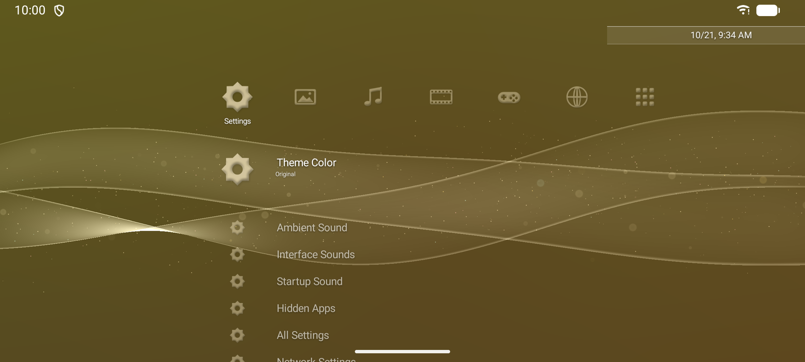
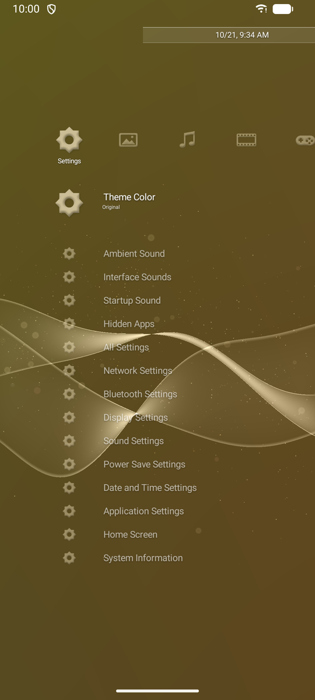
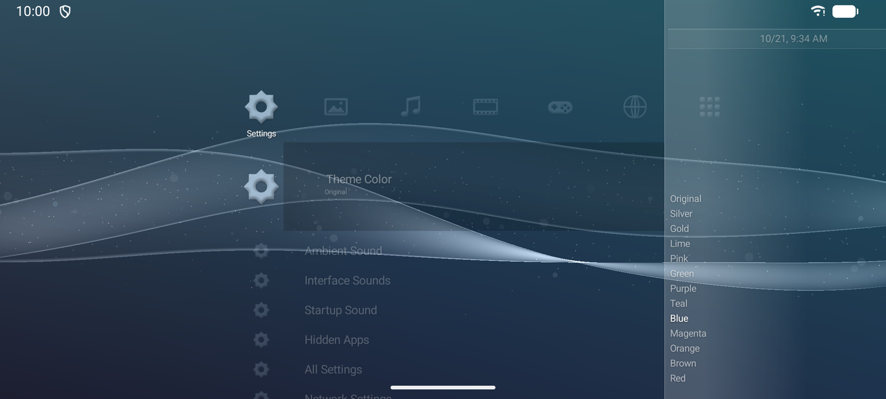

# XMB Reborn

An Android home-screen launcher in the style of the PlayStation 3's XrossMediaBar. Categories
run across, their items run down, and an animated wave and sparkles drift behind them, with
the month's background colour shifting between day and night.

It's a clean-room recreation. The layout, motion timing, colours, lighting and sound shapes were
measured from the real interface, and everything in the app was written from those measurements.
**No Sony code, artwork, fonts or sounds are included.**

<p align="center">
  
  
</p>
<p align="center">
  
</p>

## Install

1. Download `XMBReborn-<version>.apk` from [Releases](../../releases).
2. Open it on your phone and allow installing from that source when Android asks.
3. Press Home and choose **XMB Reborn**. To change it later, go to Settings → Apps → Default apps →
   Home app.

Requires Android 10 or newer and OpenGL ES 3.

## Using it

- **Swipe sideways** to change category and **up and down** to move through a list. **Flick** to
  run down a long list; touch the screen to stop it. Tap a row to focus it, then tap it again to
  open it. D-pads and game controllers work too: Ⓐ opens, Ⓑ goes back, Ⓨ/Menu opens options,
  and L1/R1 (or Page Up/Down) skip ten rows. On a keyboard, type a letter to jump to it.
- **Long-press** a row (or press Ⓨ/Menu) for its options: Open, the app's own shortcuts (like
  "New tab"), App Info, **Jump to Letter** (in long lists such as Apps), Add Widget Here, Hide,
  Uninstall.
- **Home** while you're already home glides back to the top of the Apps column.
- **"Add to Home screen"** from other apps (Chrome, Maps…) puts the shortcut in a **Shortcuts**
  column.
- **Settings** column:
  - **Theme Color:** Original follows the month, or pick one of the 12 month colours. The
    background previews each colour as you scroll.
  - **Ambient Sound:** a soft background pad of our own (the PS3 has none). It pauses whenever
    another app plays media.
  - **Interface Sounds:** the menu clicks.
  - **Startup Sound:** plays once after the phone powers on, if you've supplied a sound (see below).
  - **Widget Button:** hide the round **+** (Add Widget Here in options still works).
  - **Date and Time:** the PS3's clock bar at the top right. Off by default, since Android's
    status bar already shows the time.
  - **Backup:** save your settings, hidden apps and recent order to a file, or restore them,
    e.g. on a new phone. Widgets and the PS3 folder aren't included; Android ties those to the
    phone they were set up on. Android's own backup carries the same settings.
  - **Hidden Apps:** bring back apps you've hidden.
  - Shortcuts into Android's own settings.
- **TalkBack** reads the categories, rows and options; double-tap opens, and double-tap-and-hold
  shows options.
- Apps are grouped by the category the developer gave them (Photo, Music, Video, Game, Network),
  most recently opened first. **Apps** lists everything A–Z.

## Widgets

Every category can hold real Android widgets in a tray beside its list. The tray slides and fades
with its category, the way the lists do.

- **Add:** tap the round **+** at the bottom right (or choose **Add Widget Here** in a row's
  options). This opens Android's widget list, plus the widget's own set-up screen if it has one.
- **Move:** press and hold a widget until it lifts, then drag it up or down. In landscape, drag
  it across to the other stack. Hold it at the left or right edge of the screen to carry it to
  the next category.
- **Arrange:** press and hold without moving to make it **Bigger** or **Smaller**, give the
  category a **Wider Tray** (its list then shows icons only), or **Remove** it.
- Swiping sideways over a widget still changes category; taps and scrolling go to the widget.

## Playing PS3 games (optional, with ARMSX3)

XMB Reborn can list your PS3 games in the Game column, with each game's own icon and name, and
its background fading in when it's focused, as on a real PS3. Games play in
[ARMSX3](https://github.com/ARMSX2/ARMSX3), a separate Android port of the RPCS3 emulator. Install
that first, with your own PS3 firmware and game dumps. Neither app includes them.

1. In ARMSX3, add your games folder to its library.
2. In XMB Reborn, go to **Settings → PS3 Games → Choose Folder** and pick either your games folder
   or the folder ARMSX3's **Frontend Export** writes to.
3. Your games appear in **Game**. Opening one starts it in ARMSX3.

It reads game folders (`<Game>/PS3_GAME/PARAM.SFO`, `ICON0.PNG`, `PIC1.PNG`), ISO 9660 disc images
(`.iso`) and ARMSX3's `.ps3` export files. Games open by title id, or by file for images without
one. How well a game plays depends on ARMSX3 and your phone; PS3 emulation on Android is still
experimental and wants a recent flagship.

## Using your own PS3 sounds (optional)

The app makes its own menu clicks. If you own a PS3 firmware copy, you can have it play the
original sounds and boot chime on your own phone instead. You'll need Python, ffmpeg and adb on a
computer:

```sh
# Writes out/sounds/snd_cursor.wav, snd_decide.wav, snd_cancel.wav, snd_option.wav (and more)
python -I re/tools/rco.py <dev_flash>/vsh/resource/system_plugin.rco out/
# The boot chime
ffmpeg -i <dev_flash>/vsh/resource/coldboot_stereo.ac3 -c:a aac out/sounds/coldboot.m4a

D=/sdcard/Android/data/dev.xmbreborn/files/sounds
adb shell mkdir -p $D
adb push out/sounds/snd_cursor.wav out/sounds/snd_decide.wav out/sounds/snd_cancel.wav          out/sounds/snd_option.wav out/sounds/coldboot.m4a $D/
adb shell am force-stop dev.xmbreborn   # it picks them up when it next opens
```

(On Windows Git Bash, run `export MSYS_NO_PATHCONV=1` first.) The files stay on your phone and are
never part of the app. Delete the folder to go back to the built-in clicks.

## Building

```sh
./gradlew assembleRelease   # app/build/outputs/apk/release/app-release.apk
./gradlew testDebugUnitTest
python -I tools/e2e/e2e.py  # end-to-end checks on an emulator (refuses real phones)
```

Needs JDK 17 and the Android SDK (compileSdk 36). Release builds are signed with the key named
in your `~/.gradle/gradle.properties` (`XMB_KEYSTORE`, `XMB_KEYSTORE_PASSWORD`, `XMB_KEY_ALIAS`,
`XMB_KEY_PASSWORD`), or with the local debug key if those aren't set.

## How it was made

`docs/RE_NOTES.md` records the measurements: firmware file formats, the layout and motion
captured from the real XMB running in RPCS3, background tone curves, icon lighting, particle
density and sound envelopes. `re/tools/` has the scripts that produced them. They read a
firmware you supply and ship nothing from it.

## Licence

MIT; see [LICENSE](LICENSE). This covers this project's own code and docs only.

## Disclaimer

XMB Reborn is an unofficial fan project. It isn't affiliated with or endorsed by Sony Interactive
Entertainment. PlayStation, PS3 and XrossMediaBar (XMB) are trademarks of Sony Interactive
Entertainment Inc.
